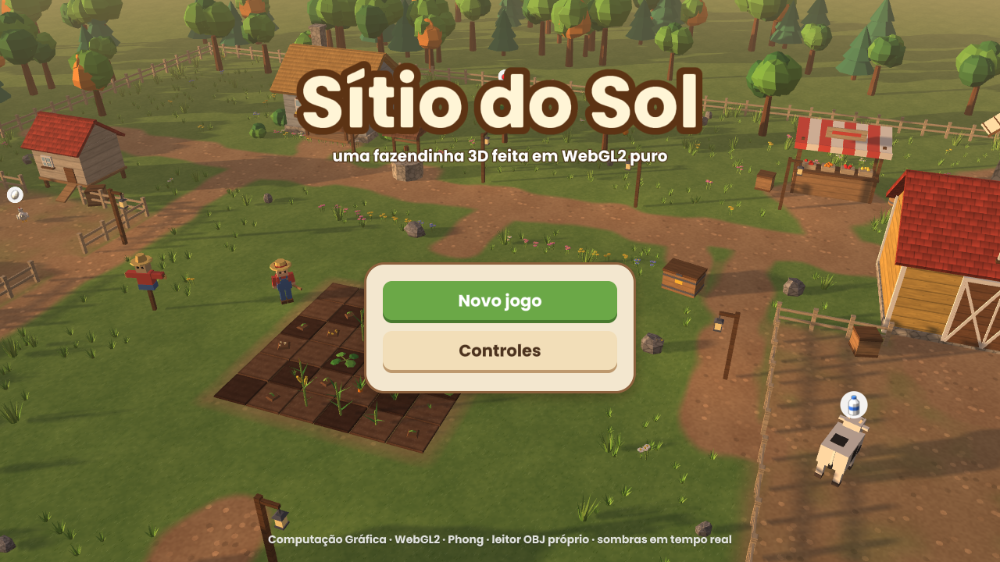
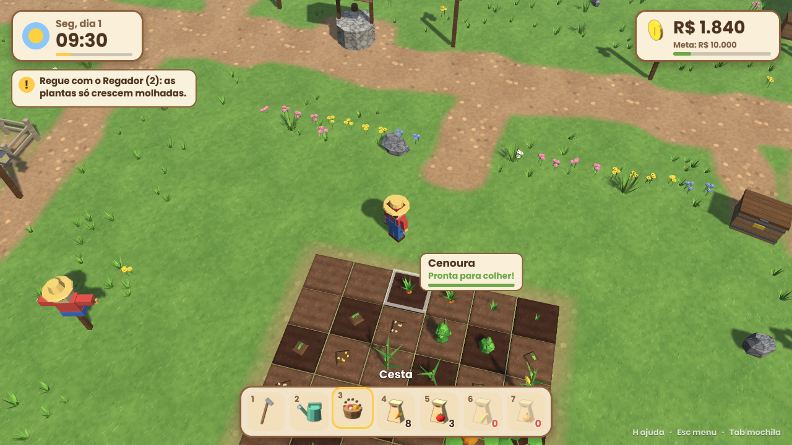
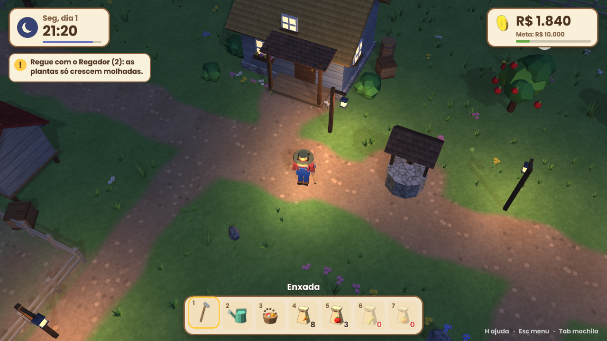
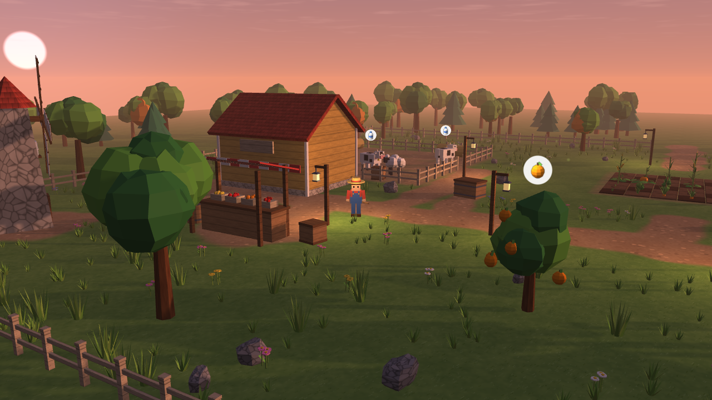
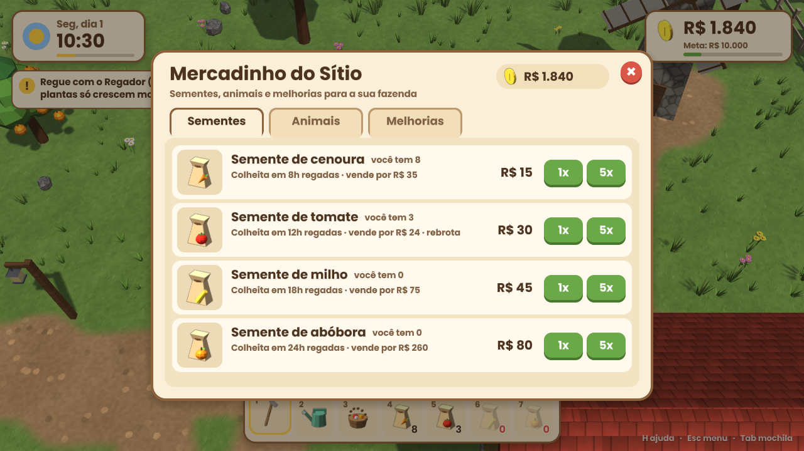

# Sítio do Sol

Jogo 3D de fazendinha feito com **WebGL 2 puro**, sem three.js nem nenhuma outra biblioteca gráfica. O jogador planta, rega e colhe, cria galinhas, vacas e ovelhas, colhe frutas, vende a produção e investe em melhorias até juntar R$ 10.000.

Trabalho da 2ª avaliação parcial de Computação Gráfica (Jogo 3D).



| | |
|---|---|
|  |  |
|  |  |

## Links

- **Jogar online:** _(https://danrockdave.github.io/Sitio-do-sol/)_
- **Vídeo de demonstração:** _(Ainda vou criar)_
- **Slides da apresentação:** _(https://docs.google.com/presentation/d/18dv4SRbfkmuPzgNmXxR6dT9H4ioQd00oji-wROKAi7w/edit?usp=sharing)_

## Como jogar

O dia no jogo dura 4 minutos reais (1 hora = 10 segundos).

1. **Prepare a terra** com a Enxada (tecla `1`) na área clara da plantação.
2. **Plante** escolhendo uma semente (`4` a `7`) e clicando no canteiro arado.
3. **Regue** com o Regador (`2`). As plantas só crescem enquanto a terra está molhada (16 h de jogo).
4. **Colha** com a Cesta (`3`) quando a planta estiver pronta (passe o mouse para ver o progresso).
5. **Animais** mostram um balão quando têm ovo, leite ou lã. Clique neles para coletar.
6. **Árvores frutíferas** dão maçãs e laranjas que crescem e mudam de cor.
7. **Venda** tudo na caixa de madeira ao lado da plantação.
8. **Compre** sementes, animais e melhorias na barraca ao norte: plantação maior, regador 3×3, galinheiro e celeiro maiores, mais árvores.
9. **Durma** na casa depois das 18:00 para pular a noite. O jogo é salvo automaticamente.

### Controles

| Tecla | Ação |
|---|---|
| `W` `A` `S` `D` / setas | Andar (relativo à câmera) |
| `Shift` | Correr |
| Mouse | Apontar canteiro ou objeto |
| Clique esquerdo / `Espaço` | Usar a ferramenta / interagir com o que está sob o mouse |
| `E` | Interagir com o objeto mais próximo (loja, caixa, casa, animal, árvore) |
| `1` a `7` | Escolher ferramenta ou semente |
| Botão direito + arrastar / `Z` `C` | Girar a câmera |
| Roda do mouse | Zoom |
| `Tab` | Mochila |
| `H` | Controles |
| `Esc` | Pausa |
| `T` | Acelerar o tempo (x1, x8, x30), útil na apresentação |
| `M` | Ligar/desligar a música (música e efeitos também ficam no menu de pausa) |
| `F1` | Esconder o HUD (para capturas) |
| `F2` | Ligar/desligar sombras |
| `F3` | Estatísticas (FPS, draw calls, triângulos) |
| `F4` | Visualizar os termos do Phong: completo, ambiente, difusa, especular, normais, sombras, albedo |

### Gráficos

No menu de pausa, **Qualidade gráfica** (alta, média ou baixa) muda o tamanho do mapa de sombras, o filtro PCF, a resolução e a densidade da decoração.

## Som

Todo o áudio é **sintetizado em tempo real com a Web Audio API**: não há nenhum arquivo de som no projeto.

- **Música de fundo gerativa** (`src/audio/music.js`): uma peça em Fá maior com seções de 8 compassos. De dia toca a 96 BPM com pad, baixo, kalimba, violão e percussão leve; à noite muda para 70 BPM com acordes com sétima e uma caixinha de música. A melodia é recomposta a cada seção (motivo A, A', B, A'' na escala pentatônica), então nunca se repete exatamente.
- **Efeitos** (`src/audio/sounds.js`): arar, regar, plantar, colher, arrancar, colher frutas, coletar ovo/leite/lã, carinho nos animais, vender (moeda), comprar, melhoria, meta alcançada, caixa de vendas, passos (grama e terra), cliques e menus, erro, dormir e o galo de manhã.
- **Vozes dos animais**: galinha, vaca e ovelha "falam" de vez em quando, com volume pela distância e posição no estéreo conforme o lado da tela.
- **Ambiente**: pássaros durante o dia e grilos à noite, com reverberação gerada por código.

## Executar

Não há etapa de compilação: o jogo é HTML + JavaScript (módulos ES) + GLSL. Como o navegador não permite carregar módulos nem fazer `fetch` de arquivos a partir de `file://`, é preciso servir a pasta com um servidor HTTP local.

**Requisitos:** um navegador com WebGL 2 (Chrome, Edge, Firefox ou Safari 15+).

### Opção 1: Python (já vem no Linux e no macOS)

```bash
git clone https://github.com/danrockdave/Sitio-do-sol.git
cd Sitio-do-sol
python3 -m http.server 8000
```

Abra <http://localhost:8000> no navegador. No Windows use `python -m http.server 8000`.

### Opção 2: Node.js

```bash
npx serve .
```

### Opção 3: VS Code

Instale a extensão **Live Server**, abra a pasta e clique em **Go Live**.

## Requisitos atendidos

| Requisito | Como foi feito | Onde |
|---|---|---|
| WebGL puro (≥ 2.0 / equivalente ao OpenGL ES 3.0) | Todo o desenho (cena 3D, céu, partículas, HUD e menus) é feito com chamadas WebGL 2 e shaders GLSL próprios | `src/gl/`, `src/render/`, `src/ui/ui.js`, `src/shaders/` |
| Apenas biblioteca de álgebra linear | `gl-matrix` (matrizes e vetores), incluída localmente | `lib/gl-matrix/` |
| Contexto gráfico só para inicialização | Um único `<canvas>`; nenhuma API de desenho 2D/HTML é usada para a cena | `index.html`, `src/gl/context.js` |
| Eventos de teclado e mouse | Eventos DOM nativos (`keydown`, `mousemove`, `wheel`…) e Pointer Events para toque | `src/core/input.js` |
| **a.I** Câmera com projeção perspectiva | Câmera em terceira pessoa que orbita e segue o fazendeiro (`mat4.perspective` + `lookAt`), com giro e zoom | `src/render/camera.js` |
| **a.II** Phong com luz em movimento | Modelo de Phong clássico (R = reflect(−L, N)) com termos ambiente, difuso e especular; o **sol e a lua se movem** com o ciclo dia/noite; à noite há até 8 luzes pontuais (lampiões e a lanterna do fazendeiro, que **anda junto com ele**) | `src/shaders/phong.frag`, `src/render/lighting.js` |
| **a.III** Objetos animados por transformações | Pernas, braços e cabeça do fazendeiro; animais andando (pernas, cabeça, asas, rabo); pás do moinho girando; tampa da caixa de vendas; árvores balançando; plantas crescendo (escala); frutas; plantas e grama ao vento e ondas do lago no vertex shader | `src/game/animate.js`, `src/game/player.js`, `src/game/animals.js`, `src/render/scene.js` |
| **a.IV** Objeto com textura | Chão (grama e terra misturadas por um *splat map*), canteiros, madeira, telhados, pedra, palha, cascas | `assets/textures/`, `src/shaders/phong.frag` (modo chão) |
| **a.V** Objeto com cor sólida | Animais, plantas, frutas, personagem (cor `Kd` do `.mtl`) | `assets/models/*.mtl` |
| **c.I** Câmera livre com movimentação | Terceira pessoa seguindo o personagem pelo sítio | `src/render/camera.js`, `src/main.js` |
| **c.II / c.III** Objetos de arquivos OBJ com leitor próprio | Todos os 76 modelos são `.obj` + `.mtl`, lidos pelo parser escrito do zero | `src/loaders/obj.js`, `src/loaders/mtl.js` |
| Extra: leitor de imagens próprio | As texturas são PPM/PGM/PAM decodificadas por um parser próprio (sem decodificação de imagem do navegador) | `src/loaders/netpbm.js` |
| Extra: som sintetizado | Música gerativa e efeitos feitos com osciladores e ruído filtrado (Web Audio), sem arquivos de áudio | `src/audio/` |

### Leitor OBJ

`src/loaders/obj.js` foi escrito sem código de terceiros e suporta:

- `v`, `vt`, `vn`, `o`, `g`, `usemtl`, `mtllib`;
- faces com qualquer número de vértices (triangulação em leque) e todos os formatos de índice (`v`, `v/vt`, `v//vn`, `v/vt/vn`), inclusive **índices negativos**;
- cálculo de normais suaves (ponderadas por área) quando o arquivo não as traz;
- inversão da coordenada V da textura;
- separação em **partes** (cada `o`/`g`), usadas para animar braços, pernas, pás do moinho etc.;
- remoção de vértices duplicados e geração de um buffer intercalado (posição, normal, UV) com índices de 32 bits.

O leitor de MTL (`src/loaders/mtl.js`) lê `Ka`, `Kd`, `Ks`, `Ke`, `Ns`, `d`/`Tr` e `map_Kd` (ignorando opções como `-s`).

## Pipeline de renderização

Por quadro (`src/render/renderer.js`):

1. **Shadow map**: profundidade renderizada do ponto de vista do sol/lua com projeção ortográfica (2048², *texel snapping* para não tremer).
2. **Céu**: triângulo de tela cheia com gradiente, sol, lua, estrelas e nuvens procedurais.
3. **Opacos**: todos os modelos com Phong, sombras com PCF 3×3, neblina e emissivo noturno (janelas e lampiões acendem).
4. **Sobreposição**: marcador do canteiro/objeto sob o mouse, com *blending*.
5. **Billboards**: partículas, vaga-lumes à noite e balões dos produtos prontos.
6. **Interface**: HUD e menus desenhados com quadriláteros WebGL; texto com fonte **SDF** (signed distance field) e retângulos arredondados calculados no shader.

Outras técnicas:

- **Instancing automático** (`src/render/queue.js`): cada parte de modelo vira uma única chamada `drawElementsInstanced` por material, não importa quantas cópias existam (cercas, grama, plantas).
- **Ícones do HUD renderizados dos próprios modelos 3D** em um framebuffer com MSAA na inicialização (`src/render/icons.js`).
- **Ciclo dia/noite** interpolando quadros-chave de cor (`src/render/lighting.js`).
- **Cenário construído no código** (`src/game/world.js`): construções, cercas com colisão, estradas pintadas no *splat map*, floresta, decoração.

## Estrutura do projeto

```
index.html              página com o canvas
privacidade.html        política de privacidade (versão para as lojas)
css/style.css           layout da página (sem desenho)
src/
  main.js               inicialização e laço principal
  core/input.js         teclado, mouse e toque (joystick, toque para andar, pinça)
  core/platform.js      detecção de toque, presets de qualidade, áreas seguras
  core/bridge.js        ponte com o app nativo e salvamento espelhado
  audio/                síntese de som: motor, efeitos e música gerativa
  gl/                   contexto, shaders, texturas, malhas (VAO), framebuffers
  loaders/              OBJ, MTL, PPM/PGM/PAM e carregamento dos assets
  render/               câmera, iluminação, renderizador, fila de instâncias, cena, chão, ícones
  shaders/              GLSL: phong, shadow, sky, billboard, ui
  ui/                   interface: fonte SDF, widgets, HUD, menus
  game/                 regras: plantação, animais, árvores, jogador, mundo, relógio, economia
  data/models.js        manifesto dos modelos (troca de modelos e pivôs de animação)
assets/
  models/               76 modelos .obj + .mtl
  textures/             texturas .ppm
  fonts/                atlas SDF da fonte (.pgm + .json)
lib/gl-matrix/          biblioteca de álgebra linear (MIT)
tools/                  scripts Python que geram modelos, texturas e fonte
```

## Regenerar os assets

Necessário apenas se você alterar os scripts (requer Python 3, NumPy, Pillow e SciPy):

```bash
python3 tools/generate_models.py     # assets/models/*.obj + .mtl
python3 tools/generate_textures.py   # assets/textures/*.ppm
python3 tools/generate_font.py       # assets/fonts/poppins_sdf.*
```# Sitio-do-sol
